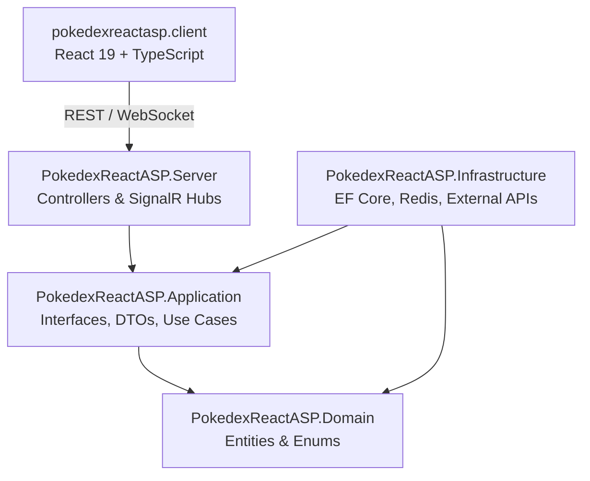

# Codebase Architecture

## Core Sections (Required)

### 1) System Architecture Pattern

The system follows **Clean Architecture** (Hexagonal/Onion Architecture):

- Dependency Inversion Principle: The `Server` and `Infrastructure` layers depend on abstractions defined in the `Application` and `Domain` layers. The core domain has zero outward dependencies.

### 2) Core Data Flow

1. **Incoming Request**: Client invokes a REST endpoint or SignalR method.
2. **Controller/Hub Layer**: Authenticates user via JWT (`ApiControllerBase.CurrentUserId`), validates input models via `ModelState` / FluentValidation.
3. **Application Services**:
   - `PokemonCatchService`: Handles server-authoritative catch mechanics (catch rate calculation, IV rolls, shiny checks, persistence, trainer EXP updates).
   - `PokemonCollectionService`: Read-only queries for user collections, statistics, summaries.
   - `PokemonEnricher`: Combines relational entity data with cached PokeAPI metadata (sprites, base stats, types, nature bonuses).
4. **Data & Cache Access**:
   - `IUnitOfWork` / `IRepository<T>` accesses PostgreSQL via `PokemonDbContext`.
   - `IPokemonCacheService` queries `ICacheService` (`ResilientCacheService` L1 memory / L2 Redis).
5. **External Integrations**:
   - `PokeApiService`: Ingests Pokémon stats and sprites.
   - `PokemonTcgApiClient`: Ingests TCG card information.

### 3) Key Design Patterns

- **Repository & Unit of Work**: Encapsulates persistence operations (`IRepository<T>`, `IUnitOfWork`, `Repository<T>`, `UnitOfWork`).
- **Resilient Multi-tier Cache**: Memory cache + Redis with circuit-breaker fallback (`ResilientCacheService`).
- **Keyed Lock Pattern**: `AsyncKeyedLocker<int>` prevents thundering-herd on cache misses for the same Pokémon ID.
- **Factory Pattern**: `IPokemonFactoryService` constructs caught `UserPokemon` instances from game mechanics contexts.
- **Background Worker**: `NewsSyncBackgroundService` runs recurring RSS feed synchronization in background.

### 4) Cross-Cutting Concerns

- **Observability**: OpenTelemetry OTLP integration exporting metrics to Prometheus, traces to Tempo, and logs to Loki (`OpenTelemetryExtensions.cs`).
- **Security & Masking**: Serilog logs mask sensitive properties (`Password`, `Token`, `SecretKey`).
- **Rate Limiting**: Built-in ASP.NET Core RateLimiter with `AuthPolicy` (5 req/min), `GlobalPolicy` (100 req/min), and `WildCatchPolicy` (20 req/min).
- **Global Error Handling**: `ExceptionHandlingMiddleware` catches unhandled exceptions and standardizes HTTP error payloads.

### 5) Evidence

- `PokedexReactASP.Server/Program.cs`
- `PokedexReactASP.Server/Middleware/ExceptionHandlingMiddleware.cs`
- `PokedexReactASP.Server/Extensions/OpenTelemetryExtensions.cs`
- `PokedexReactASP.Application/Services/PokemonEnricher.cs`
- `PokedexReactASP.Application/Services/PokemonCatchService.cs`
- `PokedexReactASP.Infrastructure/Services/ResilientCacheService.cs`
- `PokedexReactASP.Infrastructure/Repositories/UnitOfWork.cs`
